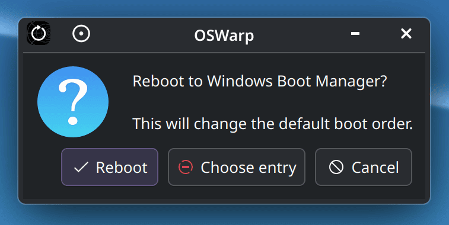
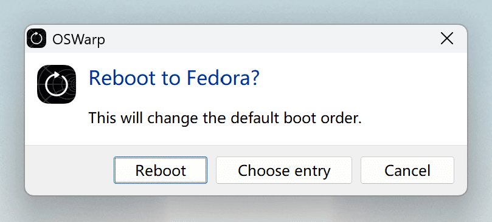
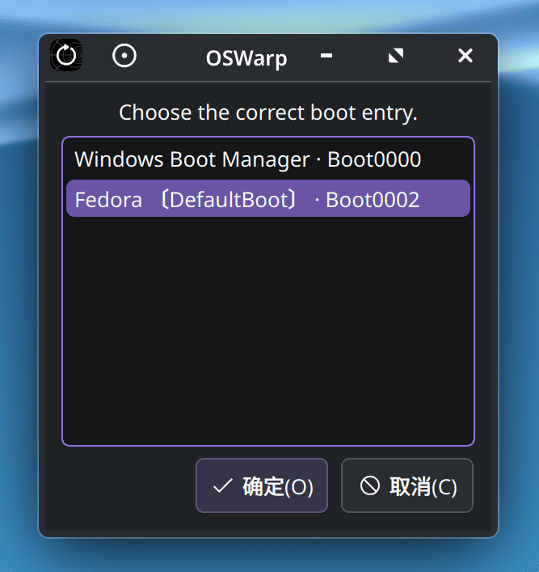
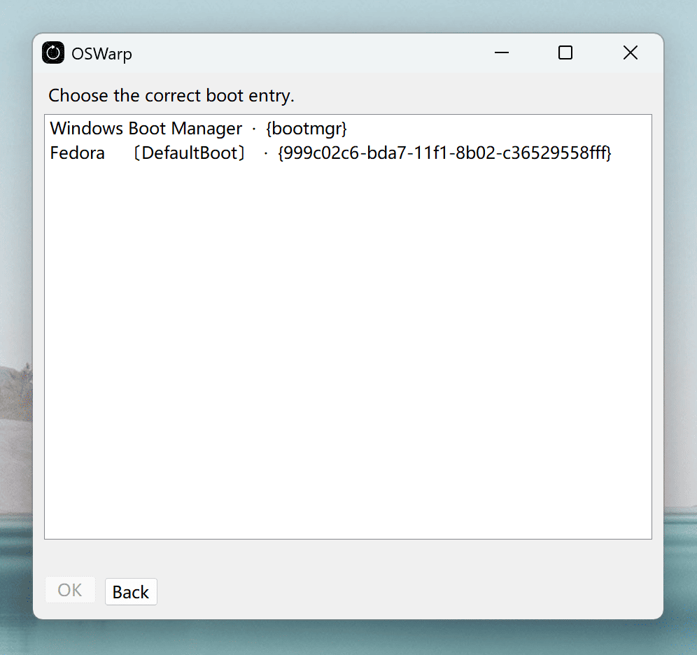
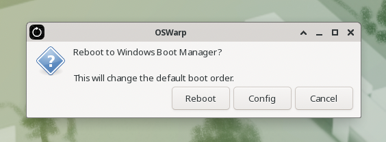
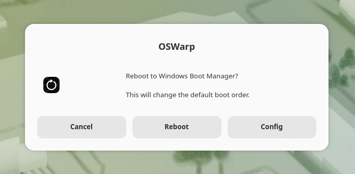

# OSWarp

[](https://www.python.org/) [](https://learn.microsoft.com/dotnet/csharp/) [](LICENSE) 

OSWarp is a shortcut for rebooting between installed operating systems. It is especially useful if you dual-boot Windows and Linux.

- Warp to another OS. Windows or Linux.
- Recognize the right boot entry automatically.
- Change boot order permanently or only one time.
- Save your boot entry selection for next time.
- Warp to UEFI settings.
- Works alongside GRUB or other bootloaders.

# Why?

I made OSWarp because I'm using a Bluetooth keyboard. Since connecting it to the system while in the GRUB menu is tedious, I decided to make something like this. Since I'm a macOS developer, a "Boot Drive" panel in the OS is very natural to me. And I don't want to run a command every time I want to do such a simple task.

## AI usage

This program was partially written with AI, using careful practices such as unit tests. It also relies on external tools as much as possible to prevent anything from going wrong. 

I reviewed all the code, and it's tested on both a VM and real hardware. Don't use it if you don't trust it.

## Screenshots

| Linux (KDE) | Windows |
| --- | --- |
|  |  |
|  |  |

## Install

### Linux

Download the Python release.

```sh
chmod a+x install.sh
./install.sh
```

It will then appear in your applications menu. You can also use the command "oswarp".

To try it without installing:

```sh
chmod a+x run.sh
./run.sh
```

### Windows

Download the Windows release and put the single "OSWarp.exe" file wherever you like.

## How it works

This tool changes the UEFI boot order or adds a one-time config when you click on "Reboot". On Linux, it uses efibootmgr. On Windows, it uses bcdedit. It can recognize the right boot entry and select it for you if you are dual-booting Windows and Linux. You can also choose one manually.

Some motherboard firmware might not support changing the boot order from software. For example, some MSI motherboards have a feature called "BBS Priority" which sometimes overwrites the changes.

The alert UI uses kdialog, zenity, or yad, depending on your desktop environment, to provide optimal visuals.

| Linux (Xfce) | Linux (Gnome) |
| --- | --- |
|  |  |

## Build

### Linux

There is no need to build.

To run tests, use:

```sh
pip install pytest
cd python
python3 -m pytest tests/
```

### Windows

Make sure you have Visual Studio and run `build.bat`.

To run tests, first run `build-test.bat`, then run the test executable.

## License

OSWarp is released under the MIT License. You can use, copy, modify, and distribute it, including for commercial use. Copies and substantial portions must keep the copyright notice and this license. The software is provided as is, without warranty. The full text is in [LICENSE](LICENSE).
